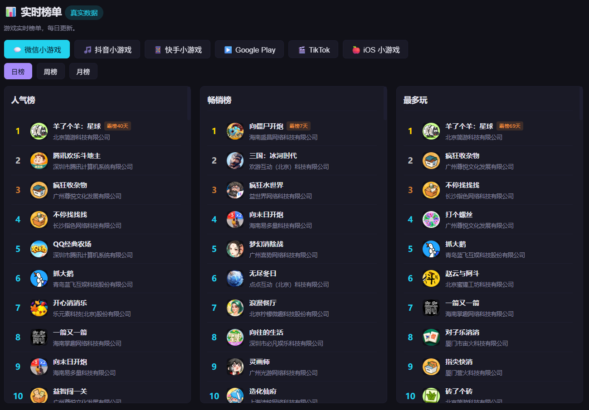
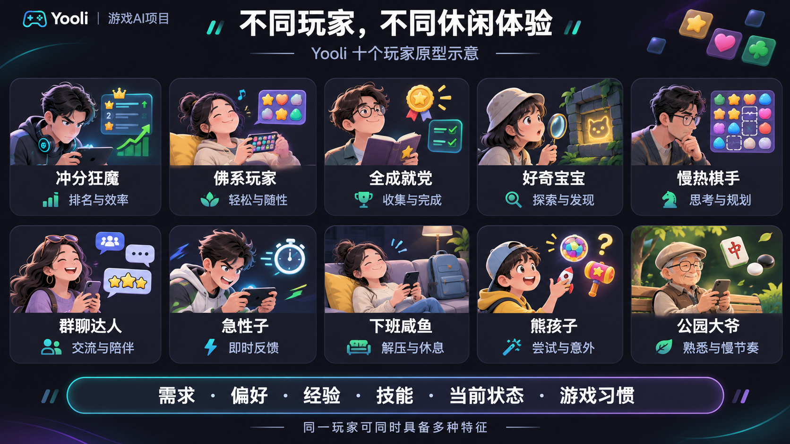
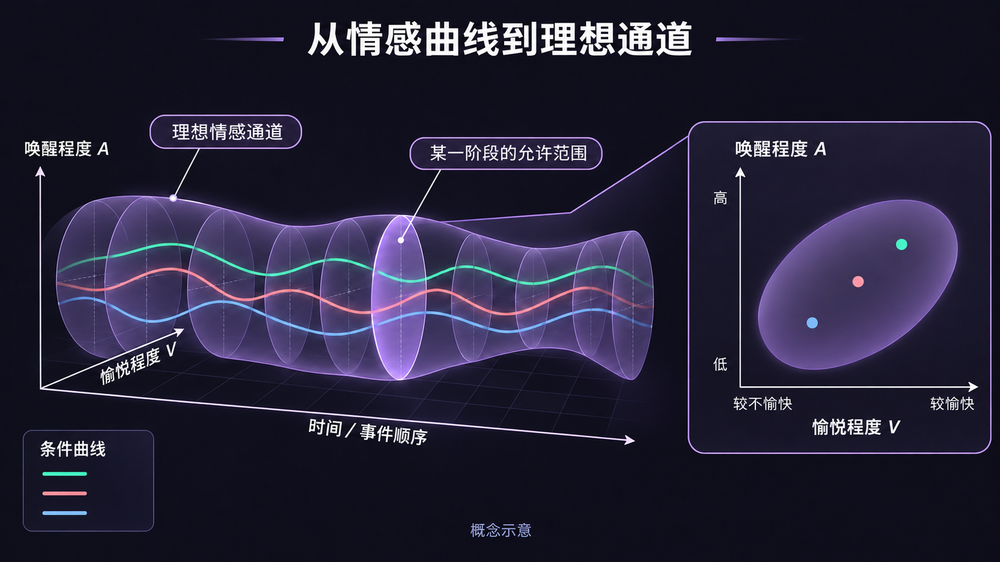
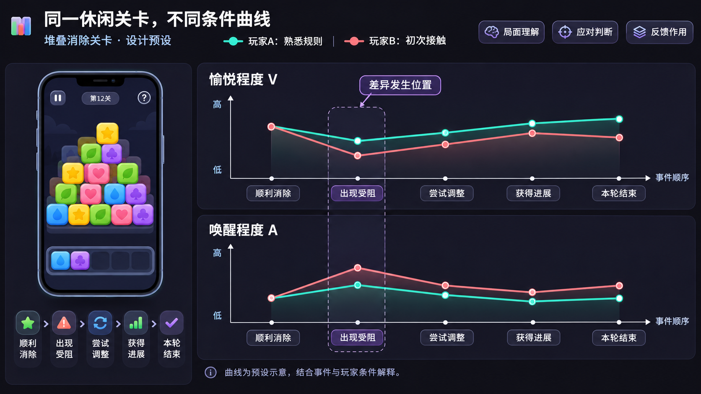
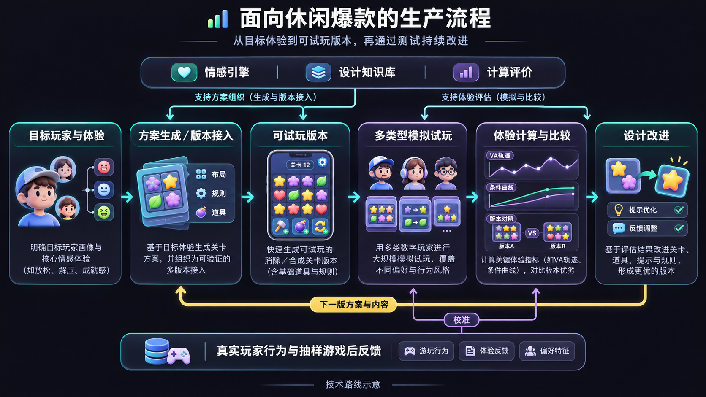
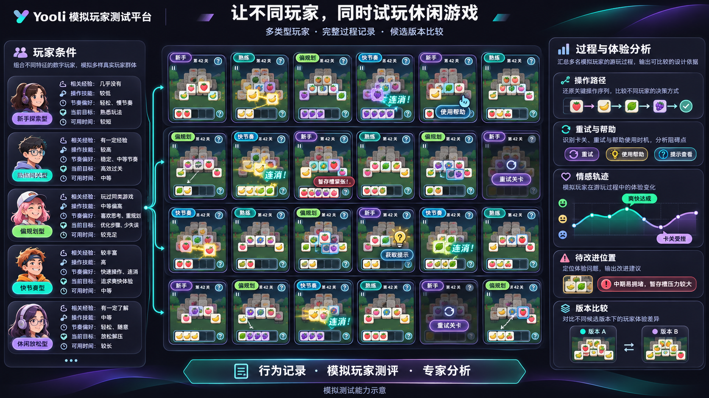
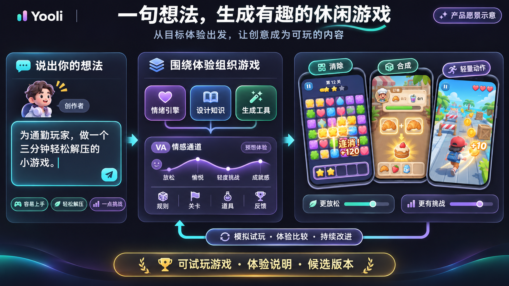

# Yooli情绪引擎：让生产爆款游戏成为一个可计算的科学工程

*Yooli · 项目技术总览｜2026-11-12*

休闲游戏正处在一个持续扩张的市场中。《2026年1—6月中国游戏产业报告》显示，2026年上半年，中国休闲移动游戏收入达到**182.05亿元**，同比增长**10.74%**；小程序移动游戏收入达到**316.57亿元**，同比增长**36.01%**。消除、合成、棋牌等轻量玩法，承载着庞大的玩家参与和商业空间。

在这样的市场里，创造一款高关注、高流水、在相关榜单上持续领先的爆款，是开发团队和发行商共同的期待。微信小游戏等平台的人气、畅销与游玩榜单，为观察这些作品提供了不同入口。

高关注意味着游戏吸引观看、讨论和分享；高流水呈现购买、付费及商业化表现；榜单领先，则体现它在特定平台和时期的竞争位置。这些结果背后，是大量玩家反复作出的选择：开始游玩、再试一次、购买内容、邀请朋友，或向他人推荐。

*市场数据来源：[《2026年1—6月中国游戏产业报告》发布报道（新华网，2026年7月31日）](https://www.xinhuanet.com/tech/20260731/c5593cc57b18411ab328cd3ed98b554c/c.html)。*

*图01｜通过人气、畅销与游玩等榜单观察休闲游戏的市场表现。榜单页面截图示意。*

**爆款的市场表现背后，是玩家愿意持续投入的体验。理解这些体验怎样形成，才能进一步把爆款生产变成可计算、可测试、可迭代的工程**。

## 一、情感体验：爆款背后的无形规律

### 1.1 简单的操作，为什么能让玩家不断投入

在《羊了个羊》中，点击选牌和完成消除，就可以组织出顺利推进、槽位紧张、意外受阻、调整后恢复，以及失败后再次尝试等不同过程。操作形式清楚，玩家面对的判断与感受却在持续变化。

《浪漫餐厅》把合成物品、交付订单和餐厅进展连接起来，让一次局部操作参与更长的目标；《水果忍者》通过连续划动、即时反馈和分数累计，支持短时投入与自定成绩追求。不同休闲玩法，用不同内容承载发现、期待、紧张、畅快和满足。

玩家记住的，往往是这些过程带来的感受：差一点就能完成的不甘，终于找到解法的畅快，得到意外奖励的惊喜，或在短暂休息中获得的轻松。一次受阻也可能成为下一次投入的起点——只要玩家看到了机会，仍然期待更好的结果。

**情感体验贯穿着玩家为什么开始、为什么继续，以及为什么愿意回来**。画面、操作、判断与反馈在每次行动中共同展开，让同样简单的点击产生丰富的体验。

### 1.2 同一个局面，为什么会有不同感受

消除关卡的暂存槽接近满时，有的玩家觉得紧张而有趣，有的已经开始烦躁，还有的认为局面仍在计划之中。感受与当前局面有关，也与玩家怎样理解局面、是否有应对办法、对结果抱有什么期待有关。

| 体验中的关键变化 | 玩家此刻可能怎样理解 | 游戏内容怎样参与 |
| --- | --- | --- |
| 从轻松转向紧张 | 剩余机会变少，继续点击可能失败。 | 遮挡、槽位与牌面组合改变判断压力。 |
| 从受挫转向期待 | 发现了新信息，或找到一种值得再试的方法。 | 提示、道具与失败反馈提供新的行动机会。 |
| 从完成转向满足 | 自己的尝试带来了进展，投入获得了回应。 | 结果呈现、奖励与后续内容表达这次行动的价值。 |

经验也会改变感受。熟悉规则的玩家可能从受阻中看到解法，初次接触的玩家可能沿着错误线索反复尝试；一次意外成功可能带来惊喜，反复出现后又成为熟悉的日常。学习、记忆和预期不断更新，体验也随之变化。

这种变化，使内容安排具有了情感上的作用。同样是失败，清楚的反馈可以让玩家看见进步，新的变化可以带来新鲜感；当行动与结果长期难以理解时，玩家则更容易失去继续尝试的兴趣。

### 1.3 一个爆款，需要容纳多种玩家

有人追求冲分和通关，有人享受随手消除，有人喜欢收集，有人只是想在短暂休息中放松。同一位玩家也会随着时间、场景和状态改变当前追求。不同的玩家会有完全不同的游戏偏好，也会在游戏中做出不同的操作，并获得不同的体验。因此，我们需要有很多的玩家原型，来理解不同的体验是如何产生的。

*图02｜十个玩家原型帮助展示不同关注点；具体建模采用需求、偏好、经验、技能、状态与习惯等条件的组合。*

人格、文化与生活背景提供分析线索；需求、可用时间、相关知识、操作技能、游玩习惯和当前目标，则共同参与这次游玩的体验。快速反馈对某些玩家很有吸引力，另一些玩家更享受慢慢规划；有人愿意使用道具，有人更看重独立完成。

玩家也在持续变化。他们通过自行尝试、攻略、视频或他人信息形成理解，通过实际操作发展技能；知识增加、执行能力提高和自信变化，又会改变下一次挑战的体验。爆款需要让目标玩家在这些变化中持续找到投入的理由。

### 1.4 情绪引擎在做什么：建模内容与感受的关系

Yooli情绪引擎从爆款游戏出发，建模**游戏内容、玩家条件、行动与理解、情感变化**之间的作用关系，让“为什么好玩”能够被表达、分析与计算。

在消除游戏中，模型连接牌面、遮挡、槽位、帮助和失败代价，分析它们怎样影响玩家的判断与感受；在合成游戏中，连接订单、产出、等待和进展；在短时动作游戏中，连接操作响应、连续表现和结果反馈。玩法、机制、关卡、道具、界面、声音、特效与数值，都参与体验的形成。

情感维度提供描述感受的坐标；认知评估连接事件、需求、目标和应对判断；情感建构相关模型表达经验、记忆和情境的作用。三者共同支持情绪引擎理解同一内容为什么会带来不同体验。

建模同时区分游戏的客观状态、玩家的主观理解和设计师的体验预想。任务是否完成、玩家是否认为自己掌握了方法、是否获得满足，分别进入对应的分析。输出连接到具体玩家、具体事件和具体内容，供后续曲线计算、设计比较与游戏生成调用。

**Yooli要构建一个能够理解玩家情感体验的引擎，让爆款背后的体验规律成为游戏生产可以使用的能力**。

## 二、爆款体验量化：用数值计算玩家情感的变化

### 2.1 从关卡内容，建立可以推演的事件过程

以一个假设的堆叠消除关卡为例，分析先记录可见牌面、遮挡关系、暂存槽、可用帮助与完成条件，再组织玩家的选择、操作和反馈。

一次点击可能同时减少牌面、占用槽位、显露新信息，并改变后续机会。模型据此推演玩家怎样理解当前局面，以及这次行动对目标、应对判断与预期意味着什么。

过程保留事件、玩家条件和采用依据。记录中的操作描述发生了什么；模型结合局面与前序经历，形成相应的理解和感受预测。对反复尝试等行为，可以比较计划执行、探索新方法、习惯性操作等不同解释，再结合后续材料检查。

这样的输入结构，使预测能够追查到具体安排。提示是否被看到、玩家怎样理解、选择是否带来进展，分别参与后续分析。

### 2.2 情感曲线：让变化对应到事件与原因

Yooli采用愉悦程度V与唤醒程度A组织情感空间。V描述感受的愉快或不愉快，A描述感受的激活程度。安静满足与兴奋激动都可以是正面体验，它们在空间中具有不同位置。

沿时间或事件顺序连接这些位置，就形成情感曲线。以消除关卡为例，一段过程可能经历顺利消除、出现受阻、尝试调整、获得进展，最后完成或失败。每个节点同时连接相应事件、行动、反馈与感受解释。

计算以具体事件和玩家条件为单位，在统一尺度上表达各节点的V与A，比较变化幅度、持续时间、事件顺序和恢复速度。每个数值连接对应的局面、行动与感受解释；条件变化时，模型据此更新后续轨迹，让体验变化成为可以比较的设计信息。

首次接触、熟悉规则和连续失败后的玩家，可以形成不同条件曲线。一次消除尝试属于局部活动，从启动到关闭属于单次游玩，多次游玩构成更长的经历。三个范围相互接续，帮助分析局部挫败、当次满足和后续参与之间的关系。

### 2.3 理想情感通道：为好体验确定可接受范围

设计目标允许玩家通过不同路径获得合适的体验。Yooli用情感通道表达这种弹性：每个阶段保留一片可接受的VA区域，连续截面沿过程连接，形成有体积的通道。

*图03｜情感通道沿时间或事件顺序展开，每个截面表达愉悦程度V与唤醒程度A的允许范围，多条条件轨迹在其中变化。概念示意。*

挑战型消除关卡可以包含可理解的压力、调整与恢复，放松型关卡可以维持较低激活，合成过程可以组织积累、接近目标与兑现后的满足。通道结合案例、目标玩家和成立条件建立，为不同体验提供不同参照。

将候选设计的预测轨迹与目标通道比较，可以定位差异发生在哪个阶段，再追查相关信息、规则、道具、反馈或数值。二维曲线便于阅读，联合VA空间用于表达完整的允许范围。

### 2.4 从曲线比较，走向设计判断

假设同一关卡分别交给熟悉规则与初次接触的玩家，两者可能在相同牌面上采用不同计划，形成不同感受。比较关注分歧从哪里开始、是否获得新信息，以及受阻后怎样恢复。

*图04｜熟悉规则与初次接触的玩家，在同一关卡事件下可能形成不同的愉悦与唤醒变化。曲线按设计预设示意。*

体验评价进一步结合过程感受，以及玩家对掌握、进步、目标与经历价值的认识。一轮失败可以伴随有效学习和继续尝试的意愿，一次完成也可能显得重复、费力或缺少满足。评价按选定范围组织完整过程。

这套方法把“哪里不好玩”转化为更明确的问题：哪些玩家，在什么事件和条件下，获得了怎样的体验；哪些改动值得比较。

### 2.5 从拆解到计算：每个目标怎样由技术实现

要把上一节的体验比较用于具体游戏，需要看懂内容安排、组织玩家条件、推演完整过程，再计算感受怎样变化。Yooli围绕这些任务安排技术分工：

- **对游戏进行拆解——专家大模型**。通过检索相关知识、分析游戏内容并调用计算工具，识别玩法、规则、关卡、道具与反馈怎样组织玩家过程，输出事件结构、体验解释和待比较的设计问题。

- **建设游戏与体验知识库——内容建模与知识检索**。将游戏规则、玩家差异、情感关系和案例中的设计安排组织为可检索的知识，为专家大模型提供概念定义、已知关系与成立条件。拆解与推演沿这些知识约束展开，形成可以持续复用的内容结构。

- **计算玩家情感变化——体验状态与时序计算模型**。结合事件、玩家条件和前序经历，推演局面理解、应对判断与具体感受，在统一尺度上表达V与A的变化，生成条件曲线，并与目标通道比较，定位差异出现的阶段及相关条件。

- **呈现不同玩家的游玩过程——模拟玩家与执行系统**。玩家模型管理各自的知识、记忆、偏好与当前状态，规划下一步行动；操作策略和游戏接口完成具体输入，记录选择、反馈、重试与帮助使用，为体验计算提供不同玩家的完整过程。

- **让预测贴近真实玩家——行为数据分析与模型校准**。将实际游玩的操作路径、受阻位置、重试和后续参与，与模拟过程进行对照，结合体验反馈调整玩家条件、行动策略与计算依据，使后续推演更贴近目标玩家的表现。

这些部分通过共同的事件与玩家条件衔接：知识库支持专家拆解，拆解结果进入过程推演，模拟试玩补充行动与反馈，计算结果再交给专家模型解释和组织改进方案。具体问题由此连接到可比较的设计变化，进入后续生成、验证与改进流程。

目前，项目已有19组跨品类主案例及扩展比较、41项情感过程与42条理想路径，并在明确设计预设下形成700余条条件曲线。这些内容为休闲游戏的体验建模、方案比较和生成提供基础，计算服务、游戏接入与可执行模拟沿技术路线推进。

**情感体验解释怎样发生，曲线表达怎样变化，通道提供目标范围；计算把这些认识连接到可以比较的设计决策**。

## 三、爆款怎么生产：让生成、验证与改进共同工作

### 3.1 从目标体验组织生产流程

生产首先明确服务什么玩家，希望他们经历什么，以及内容、操作、时长和商业化需要满足哪些条件。既有游戏可以从当前体验问题进入，新内容可以从目标体验进入。

例如，一款面向短时休息的消除游戏，希望玩家快速理解操作，在一段可应对的压力后获得进展，并带着完成感结束。这个目标可以转成信息呈现、局面变化、帮助机会、奖励反馈与结束节奏的设计要求。

Yooli规划的生产流程，将目标体验、方案组织、可试玩版本、多类型模拟、计算评价和设计改进连接起来。每轮保留版本、玩家条件与比较依据，让下一次修改承接上一轮发现。

*图05｜从目标玩家与体验出发，组织生成、试玩、比较与改进，真实游玩数据参与持续优化。规划中的技术路线示意。*

### 3.2 游戏生成：把体验要求变成可试玩内容

生成方向以目标玩家、体验模式和实现约束为输入，调用设计知识组织玩法、机制、关卡、道具与反馈，再通过组件、代码和工具形成可试玩版本。

对于上述消除关卡，方案需要说明基础操作怎样被理解、何时增加局面压力、玩家有哪些调整机会，以及进展怎样被清楚反馈。牌面、遮挡、槽位、帮助和奖励共同支持预想过程，并形成可交给实现环节的内容安排。

生成可以先作用于现有玩法中的新关卡，也可以比较相同规则下的多种布局和节奏。候选版本进入同一套计算与测试流程，团队据此判断它们分别适合哪些玩家，哪些安排值得保留。

### 3.3 模拟验证：让许多不同玩家实际经历候选版本

Yooli计划构建可调参的模拟玩家，让不同知识、偏好、技能与当前状态进入完整游玩。它们依据各自可见信息和已有经历选择行动，由操作策略体现执行速度、准确性与风格。

测试需要保留差异。同一布局中，有的玩家先规划消除顺序，有的边点击边观察；有的主动使用帮助，有的保留道具；失败后，有的重试，有的切换活动或结束。玩家的理解与能力也会随着反馈更新。

*图06｜多种玩家条件进入候选关卡，分别记录操作、重试与帮助使用，汇总体验推演和版本比较。规划中的模拟测试能力示意。*

系统记录完整过程，专家结合事件、玩家测评和体验计算定位问题。比较关注预想体验在什么条件下成立：新手是否理解了提示，熟练玩家是否保留发现机会，受阻是否带来新材料，局部问题是否影响整次游玩。

批量试玩由此提供多种玩家立场的过程材料，支持团队在开发中更早比较候选版本，并为后续实际玩家测试确定重点。

### 3.4 设计改进：把测试发现转成具体调整

设计改进围绕已定位的问题，组织信息、规则、局面压力、道具、失败代价、奖励和反馈的候选变化，再比较收益与代价。

例如，如果新手持续误判点击后的槽位变化，可以比较常驻提示、受阻后提示和主动求助三种安排；如果关卡中段长期缺少进展，可以比较局面组合、帮助机会与局部奖励；如果重试负担过高，可以检查重新开始、等待和重复操作所占的过程。

不同方案同时影响多个目标。更早提示可能帮助推进，也可能减少自主发现；降低重试负担可以支持继续尝试，也会改变挑战节奏。团队需要按目标玩家和体验要求判断这些取舍，再把选定方案送回下一轮试玩。

当前已开展失败代价、提示时机和操作负担三项有限变量的设计预设试算。交付包括改哪里、预想影响谁、前后体验如何变化，以及采用方案的理由。

### 3.5 一句话，生成一个让人想继续玩的游戏

Yooli面向的产品体验，是让创作者用一句话表达想法，系统据此组织玩法、关卡和反馈，生成有趣、可玩的休闲游戏，并围绕目标玩家持续调整。

> 为通勤玩家，做一个三分钟轻松解压的小游戏，容易上手，也有一点让人想再试一次的挑战。

这句话包含了服务谁、在什么场景游玩、投入多长时间，以及希望获得什么感受。情绪引擎将这些要求组织为体验目标，设计知识库提供相应的内容安排，生成工具把方案转成可试玩版本。消除、合成或轻量动作，都可以成为承载这段体验的候选形式。

*图07｜从一句体验要求出发，组织设计知识与生成工具，形成可试玩游戏、体验说明与候选版本，并通过模拟试玩和体验比较持续调整。产品愿景示意。*

创作者获得的将是一套能够继续推进的设计成果：可试玩的游戏、关键体验的说明，以及可比较的候选版本。希望更放松，可以调整压力与节奏；希望更有挑战，可以增加判断空间与应对机会；希望更适合新手，可以优化信息呈现和反馈。每次调整都连接到玩家将会经历什么。

对于已有产品，同样的能力可以用于生成新关卡、改变奖励与道具安排、比较不同节奏，帮助团队持续扩展内容。对于新想法，则可以从一句体验要求开始，逐步形成方案、版本和能够持续改进的游戏。

**Yooli要让一句创意长成有趣的游戏，让爆款生产拥有可计算的体验目标、可调用的设计知识和可持续改进的生成能力**。
