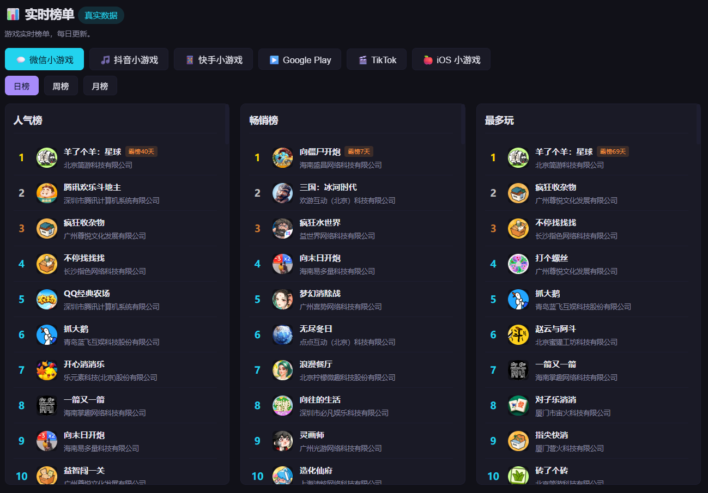
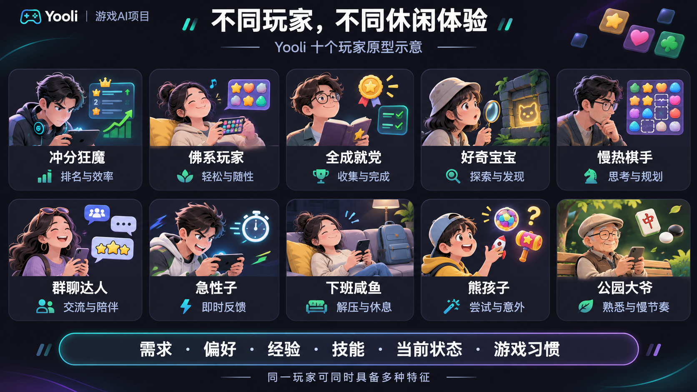
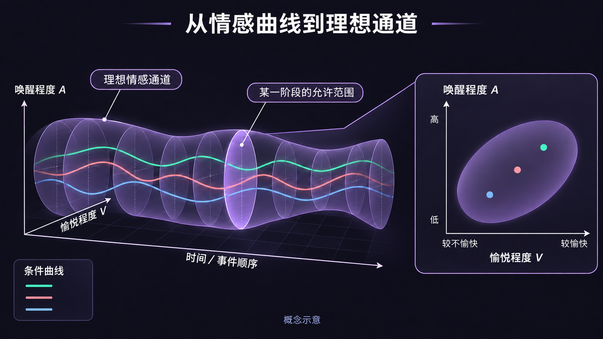
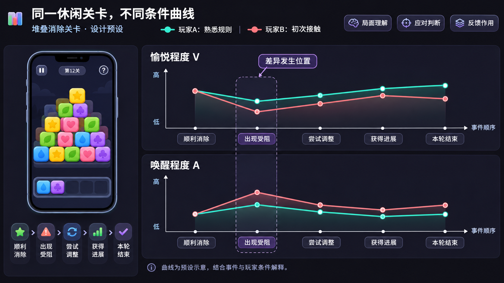
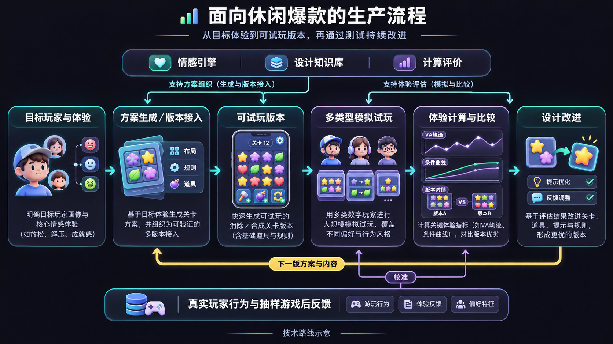
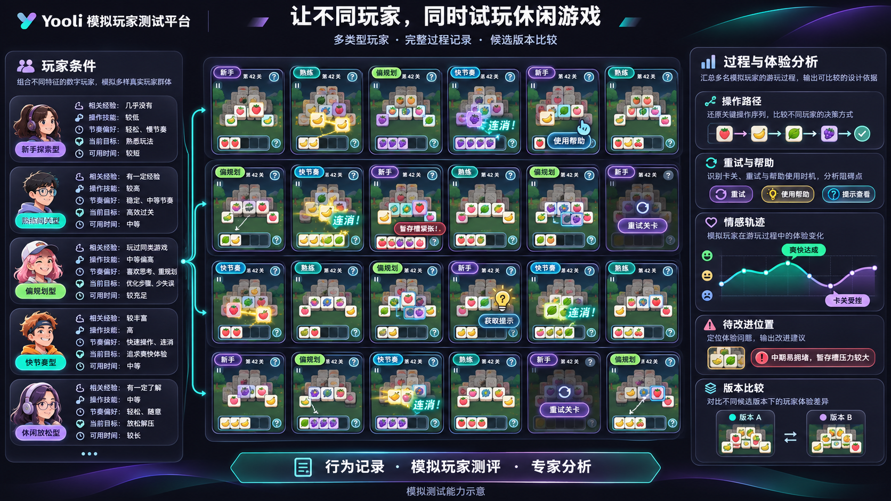
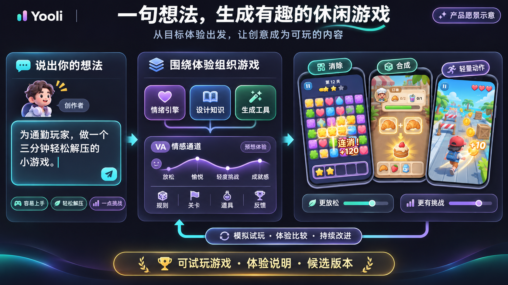

# Yooli情绪引擎：让生产爆款游戏成为一个可计算的科学工程

*Yooli · 项目技术总览｜2026-11-12*

休闲游戏正处在一个持续扩张的市场中。《2026年1—6月中国游戏产业报告》显示，2026年上半年，中国休闲移动游戏收入达到**182.05亿元**，同比增长**10.74%**；小程序移动游戏收入达到**316.57亿元**，同比增长**36.01%**。消除、合成、棋牌等轻量玩法，承载着庞大的玩家参与和商业空间。

在这样的市场里，创造一款高关注、高流水、在相关榜单上持续领先的爆款，是开发团队和发行商共同的期待。微信小游戏等平台的人气、畅销与游玩榜单，为观察这些作品提供了不同入口。

高关注意味着游戏吸引观看、讨论和分享；高流水呈现购买、付费及商业化表现；榜单领先，则体现它在特定平台和时期的竞争位置。这些结果背后，是大量玩家反复作出的选择：开始游玩、再试一次、购买内容、邀请朋友，或向他人推荐。

*市场数据来源：[《2026年1—6月中国游戏产业报告》发布报道（新华网，2026年7月31日）](https://www.xinhuanet.com/tech/20260731/c5593cc57b18411ab328cd3ed98b554c/c.html)。*

*图01｜通过人气、畅销与游玩等榜单观察休闲游戏的市场表现。榜单页面截图示意。*

**爆款的市场表现背后，是玩家愿意持续投入的体验。理解这些体验怎样形成，才能进一步把爆款生产变成可计算、可测试、可迭代的工程**。

## 一、情感体验：爆款背后的无形规律

### 1.1 简单的操作，为什么能让玩家不断投入

在《羊了个羊》中，点击选牌和完成消除，就可以组织出顺利推进、槽位紧张、意外受阻、调整后恢复，以及失败后再次尝试等不同过程。操作形式清楚，玩家面对的判断与感受却在持续变化。

《浪漫餐厅》把合成物品、交付订单和餐厅进展连接起来，让一次局部操作参与更长的目标；《水果忍者》通过连续划动、即时反馈和分数累计，支持短时投入与自定成绩追求。不同休闲玩法，用不同内容承载发现、期待、紧张、畅快和满足。

玩家记住的，往往是这些过程带来的感受：差一点就能完成的不甘，终于找到解法的畅快，得到意外奖励的惊喜，或在短暂休息中获得的轻松。一次受阻也可能成为下一次投入的起点——只要玩家看到了机会，仍然期待更好的结果。

**情感体验贯穿着玩家为什么开始、为什么继续，以及为什么愿意回来**。画面、操作、判断与反馈在每次行动中共同展开，让同样简单的点击产生丰富的体验。

### 1.2 同一个局面，为什么会有不同感受

消除关卡的暂存槽接近满时，有的玩家觉得紧张而有趣，有的已经开始烦躁，还有的认为局面仍在计划之中。感受与当前局面有关，也与玩家怎样理解局面、是否有应对办法、对结果抱有什么期待有关。

| 体验中的关键变化 | 玩家此刻可能怎样理解 | 游戏内容怎样参与 |
| --- | --- | --- |
| 从轻松转向紧张 | 剩余机会变少，继续点击可能失败。 | 遮挡、槽位与牌面组合改变判断压力。 |
| 从受挫转向期待 | 发现了新信息，或找到一种值得再试的方法。 | 提示、道具与失败反馈提供新的行动机会。 |
| 从完成转向满足 | 自己的尝试带来了进展，投入获得了回应。 | 结果呈现、奖励与后续内容表达这次行动的价值。 |

经验也会改变感受。熟悉规则的玩家可能从受阻中看到解法，初次接触的玩家可能沿着错误线索反复尝试；一次意外成功可能带来惊喜，反复出现后又成为熟悉的日常。学习、记忆和预期不断更新，体验也随之变化。

这种变化，使内容安排具有了情感上的作用。同样是失败，清楚的反馈可以让玩家看见进步，新的变化可以带来新鲜感；当行动与结果长期难以理解时，玩家则更容易失去继续尝试的兴趣。

### 1.3 一个爆款，需要容纳多种玩家

有人追求冲分和通关，有人享受随手消除，有人喜欢收集，有人只是想在短暂休息中放松。同一位玩家也会随着时间、场景和状态改变当前追求。不同的玩家会有完全不同的游戏偏好，也会在游戏中做出不同的操作，并获得不同的体验。因此，我们需要有很多的玩家原型，来理解不同的体验是如何产生的。

*图02｜十个玩家原型帮助展示不同关注点；具体建模采用需求、偏好、经验、技能、状态与习惯等条件的组合。*

## 二、情绪引擎：把情感体验变成可计算的目标

### 2.1 从体验观察到情感曲线

体验不是模糊的感受，而是可以记录、比较和分析的过程。**情感曲线**记录玩家在一次完整游玩中，体验如何随时间变化——什么时候轻松，什么时候紧张，什么时候感到畅快或受挫。

不同关卡、不同玩家、不同操作选择，会形成不同的曲线。把大量曲线放在一起比较，就能发现内容安排与体验变化之间的关系：哪些设计让玩家感到进步，哪些安排制造了不必要的困难，哪些时刻让人想再来一次。

*图03｜情感曲线记录体验随时间的变化；理想情感通道描述目标体验应有的起伏范围。*

### 2.2 理想情感通道：为体验设定目标

不同的体验目标对应不同的情感通道。一个适合通勤时短暂放松的关卡，理想通道可能在低压力区间平稳波动；一个鼓励反复挑战的关卡，理想通道可能包含适度的紧张与释放节奏。

**理想情感通道**不是一条固定曲线，而是一个目标范围。它描述了"好的体验"应该长什么样，为内容设计提供了可比较、可判断的参考。当实际玩家曲线与理想通道偏离时，就能定位问题出在哪个环节。

### 2.3 关卡条件曲线：把设计与体验连接起来

每一关的内容——牌面布局、遮挡方式、道具位置、奖励时机——构成了一组**条件**。这些条件决定了玩家面对什么局面、有哪些选择、结果如何反馈。**关卡条件曲线**描述这些条件随关卡进展的变化，与情感曲线对照，就能看到设计安排怎样影响了体验。

*图04｜同一关卡在不同条件下的曲线变化，帮助比较设计安排对体验的影响。*

## 三、从可计算到可生产：情绪引擎的工程化

### 3.1 面向休闲爆款的生产流程

把情感体验变成可计算的目标后，整个生产流程也随之改变。传统流程依赖经验判断和反复试错，情绪引擎驱动的流程则让每一步都有可参考的依据。

*图05｜从体验目标出发，经过设计知识、生成工具、模拟试玩到体验比较，形成可持续改进的闭环。*

### 3.2 设计知识库：把经验变成可调用的知识

设计知识库整理了休闲游戏中常见的设计模式、内容安排与体验效果之间的关系。它不是固定的规则集，而是一个可以查询、比较和扩展的知识系统。

当团队为某种体验目标寻找内容方案时，知识库提供经过整理的候选；当模拟试玩发现问题时，知识库帮助定位可能的调整方向。

### 3.3 模拟试玩：在开发中提前看到体验

**模拟玩家**是情绪引擎的核心能力之一。通过建模不同类型的玩家——他们的需求、偏好、技能和习惯——系统可以批量模拟试玩，生成体验过程材料，帮助团队在开发早期就比较候选方案。

*图06｜多类型模拟玩家批量试玩，生成不同立场的过程材料，支持早期比较。*

批量试玩由此提供多种玩家立场的过程材料，支持团队在开发中更早比较候选版本，并为后续实际玩家测试确定重点。

### 3.4 设计改进：把测试发现转成具体调整

设计改进围绕已定位的问题，组织信息、规则、局面压力、道具、失败代价、奖励和反馈的候选变化，再比较收益与代价。

例如，如果新手持续误判点击后的槽位变化，可以比较常驻提示、受阻后提示和主动求助三种安排；如果关卡中段长期缺少进展，可以比较局面组合、帮助机会与局部奖励；如果重试负担过高，可以检查重新开始、等待和重复操作所占的过程。

不同方案同时影响多个目标。更早提示可能帮助推进，也可能减少自主发现；降低重试负担可以支持继续尝试，也会改变挑战节奏。团队需要按目标玩家和体验要求判断这些取舍，再把选定方案送回下一轮试玩。

当前已开展失败代价、提示时机和操作负担三项有限变量的设计预设试算。交付包括改哪里、预想影响谁、前后体验如何变化，以及采用方案的理由。

### 3.5 一句话，生成一个让人想继续玩的游戏

Yooli面向的产品体验，是让创作者用一句话表达想法，系统据此组织玩法、关卡和反馈，生成有趣、可玩的休闲游戏，并围绕目标玩家持续调整。

> 为通勤玩家，做一个三分钟轻松解压的小游戏，容易上手，也有一点让人想再试一次的挑战。

这句话包含了服务谁、在什么场景游玩、投入多长时间，以及希望获得什么感受。情绪引擎将这些要求组织为体验目标，设计知识库提供相应的内容安排，生成工具把方案转成可试玩版本。消除、合成或轻量动作，都可以成为承载这段体验的候选形式。

*图07｜从一句体验要求出发，组织设计知识与生成工具，形成可试玩游戏、体验说明与候选版本，并通过模拟试玩和体验比较持续调整。产品愿景示意。*

创作者获得的将是一套能够继续推进的设计成果：可试玩的游戏、关键体验的说明，以及可比较的候选版本。希望更放松，可以调整压力与节奏；希望更有挑战，可以增加判断空间与应对机会；希望更适合新手，可以优化信息呈现和反馈。每次调整都连接到玩家将会经历什么。

对于已有产品，同样的能力可以用于生成新关卡、改变奖励与道具安排、比较不同节奏，帮助团队持续扩展内容。对于新想法，则可以从一句体验要求开始，逐步形成方案、版本和能够持续改进的游戏。

**Yooli要让一句创意长成有趣的游戏，让爆款生产拥有可计算的体验目标、可调用的设计知识和可持续改进的生成能力**。

---

## 📬 联系方式

- **WeChat**: [294318018](#)
- **Email**: [26260690145@m.fudan.edu.cn](mailto:26260690145@m.fudan.edu.cn)
